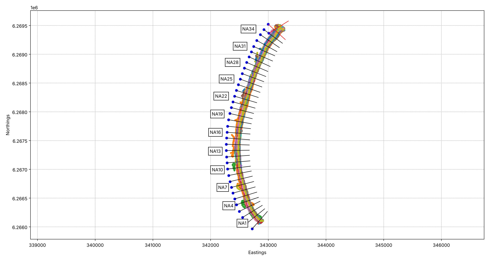

# Auto-generate transects

By Abhishek Anand, PhD student, University of California, Irvine.

`auto_generate_transects.py` makes shore-normal transects along your reference shoreline and saves them as a .geojson for the normal CoastSat workflow, so you don't have to draw them in QGIS.

## How to run

From the CoastSat folder, after downloading images and digitising a reference shoreline with `SDS_preprocess.get_reference_sl`:

```
python examples/transect_generation/auto_generate_transects.py --sitename NARRA
```

This saves `data/NARRA/NARRA_transects.geojson` and a QC figure next to it. Load the transects as usual:

```python
transects = SDS_tools.transects_from_geojson('data/NARRA/NARRA_transects.geojson')
```

## Sea side

Each transect starts on land and ends in the sea. The script finds the sea side by checking MNDWI (positive over water) on a few clear downloaded images. If you already know it, use `--sea-side left` or `--sea-side right` (relative to the direction you drew the shoreline).

## Check the result

In the QC figure, the blue triangles (seaward ends) should all be in the water. Transects in red have `check=True` in the file. Look at them in QGIS before running the intersection.



*Synthetic test coast. MNDWI is in the background (blue = water). The red transects on the right are outside the image, so their sea side could not be checked.*

## Options

- `--spacing` distance between transects, default 100 m
- `--land-length`, `--sea-length` length on each side of the shoreline, default 200 m
- `--shoreline`, `--epsg` use your own shoreline file (.geojson or .pkl)
- `--prefix` transect names, e.g. `TA` gives TA1, TA2...
- `--out` output file
